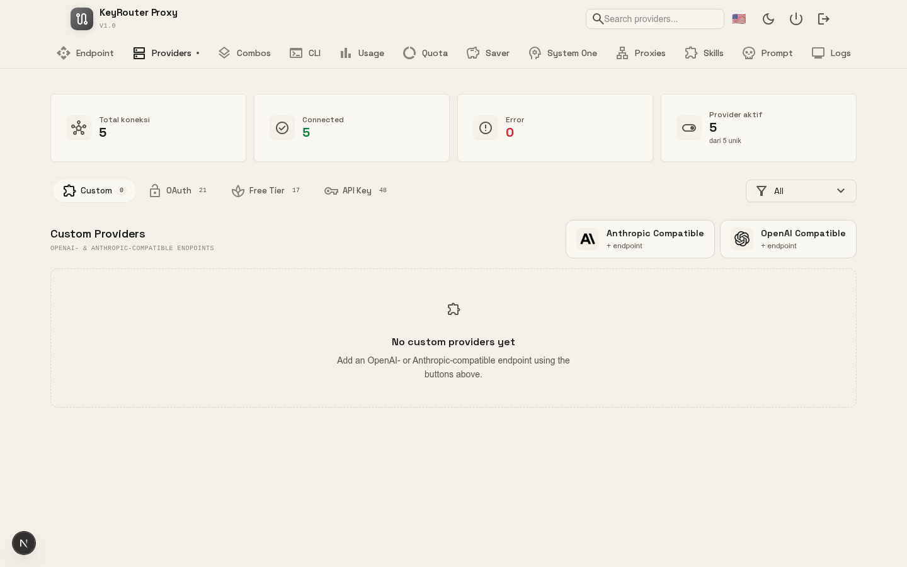

<div align="center">



# KeyRouter

**One endpoint. Every AI you already pay for. Zero wasted tokens.**

Connect Claude Code, Codex, Cursor, Gemini, OpenCode, Cline, and other coding tools to
40+ providers and 100+ models through a single self-hosted API. KeyRouter routes each
request to the best available model, falls back automatically, and shrinks your token
bill while you keep your subscriptions.

[](https://www.npmjs.com/package/keyrouter)
[](https://www.npmjs.com/package/keyrouter)
[](https://github.com/keyzakyy-dev/keyrouter/blob/main/LICENSE)
[](https://github.com/keyzakyy-dev/keyrouter)

**[⚡ Quick Start](#quick-start) · [🧠 How it works](#how-it-works) · [✨ Features](#features) · [📖 Documentation](#documentation) · [🌐 Website](https://keyrouter.com)**

</div>

---

## Overview

KeyRouter is a privacy-first AI router you host yourself. It sits between your coding
tools and AI providers, then handles the tedious parts so you can just keep coding:

- **One API key and endpoint** for every tool, instead of a different config per provider.
- **Smart routing** that picks a model for each request and falls back across tiers.
- **Token savings** that reduce how much you send and how much you spend.
- **Self-hosted by design** so your keys and traffic stay under your control.

Start in minutes with `npx keyrouter`. No account, no signup, no cloud lock-in.

---

## Quick Start

### Option 1: npm (recommended for desktop)

Install the global CLI, then run it:

```bash
npm install -g keyrouter
keyrouter
```

Or run directly without installing anything:

```bash
npx keyrouter
```

The dashboard opens at <http://localhost:20128>. Log in with the password you set
(the default is `123456`; change it after first login).

### Option 2: Docker (server / VPS)

```bash
docker run -d --name keyrouter \
  -p 20128:20128 \
  -v "$HOME/.keyrouter:/app/data" \
  -e DATA_DIR=/app/data \
  keyzakyy-dev/keyrouter:latest
```

Published images are available on [Docker Hub](https://hub.docker.com/r/keyzakyy-dev/keyrouter)
and [GHCR](https://github.com/keyzakyy-dev/keyrouter/pkgs/container/keyrouter) for
amd64 and arm64.

### Option 3: from source

```bash
git clone https://github.com/keyzakyy-dev/keyrouter.git
cd keyrouter
cp .env.example .env
npm install
npm run build
npm run start
```

### Connect your first provider

1. Open the dashboard.
2. Go to **Providers**, then connect a free provider such as **Kiro AI** (free Claude)
   or **OpenCode Free** (no login) to try it immediately.
3. Add any paid providers you subscribe to.

### Point a CLI tool at KeyRouter

```text
Claude Code / Codex / OpenClaw / Cursor / Cline settings:
  Endpoint : http://localhost:20128/v1
  API Key  : [copy from dashboard]
  Model    : kr/claude-sonnet-4.5
```

All tools that speak the OpenAI or Claude API work out of the box.

---

## Why KeyRouter?

**You are probably paying for more than you use:**

- Subscription quotas expire at the end of every month, even when unused.
- Rate limits hit you in the middle of a task, forcing you to wait.
- Tool output such as `git diff`, `grep`, and `ls` burns input tokens on every turn.
- Each provider needs its own API key, endpoint, and setup to stay working.
- Switching between providers manually is slow and easy to get wrong.

**KeyRouter removes the friction:**

- **RTK Token Saver** compresses tool results before they reach the model, reducing
  input tokens by 20-40% per request.
- **Quota tracking** tells you how much of each subscription is left, so you can use
  every bit before it resets.
- **Automatic fallback** moves you from subscription to cheap to free, in order, with
  no downtime and no manual intervention.
- **Multi-account support** spreads requests across several accounts for the same
  provider, giving you more headroom.
- **One setup** works across every OpenAI/Claude-compatible CLI tool.

---

## How It Works

```text
┌──────────────────┐
│   Your CLI tool  │   Claude Code, Codex, OpenClaw, Cursor, Cline…
│                  │
└────────┬─────────┘
         │  http://localhost:20128/v1
         ▼
┌──────────────────────────────────────────────┐
│              KeyRouter (router)               │
│  • RTK Token Saver: compress tool output      │
│  • Format translation: OpenAI ↔ Claude        │
│  • Quota tracking and auto token refresh      │
└────────┬─────────────────────────────────────┘
         │
         ├─→ Tier 1: Subscription (Claude Code, Codex, Copilot)
         │        when quota runs out…
         ├─→ Tier 2: Cheap (GLM, MiniMax)
         │        when budget is exceeded…
         └─→ Tier 3: Free (Kiro, OpenCode Free, Vertex)
```

Result: you keep coding, spend less per request, and never hit a hard stop.

---

## Features

| Area | What it does | Why it matters |
| --- | --- | --- |
| **RTK Token Saver** | Compresses `git diff`, `grep`, `ls`, and other tool output before it reaches the LLM | Cuts input tokens by 20-40% per request |
| **Smart 3-tier fallback** | Routes subscription → cheap → free automatically | Keeps you moving with zero downtime |
| **Format translation** | Converts between OpenAI, Claude, Gemini, Cursor, Kiro, and Vertex | One endpoint works with any CLI tool |
| **Multi-account** | Manages several accounts per provider | Balances load and adds redundancy |
| **Auto token refresh** | Renews OAuth tokens in the background | No manual re-login |
| **Custom combos** | Build unlimited model combinations with a routing strategy | Tailor fallback to your workload |
| **Request logging** | Live console log with per-request detail | Makes troubleshooting easy |
| **Usage analytics** | Tracks tokens, cost, and trends over time | Find where to optimize |
| **Per-key limits** | Token budget and request rates per API key | Resell access safely with HTTP 429 |
| **Prompt injection** | Injects system prompts or chat scripts per global, key, or model | Adds personas at the router level |
| **Proxy pools** | Server-side health checks, rotation, dead-pool cleanup | Keeps a large key fleet healthy |
| **Deploy anywhere** | Localhost, VPS, Docker, Kubernetes | Fits your hosting preferences |

---

## CLI

### Common commands

```bash
keyrouter                    # start with default settings
keyrouter --port 8080        # use a custom port
keyrouter --no-browser       # do not open the browser
keyrouter --skip-update      # skip the auto-update check
keyrouter --help             # show all options
```

### Connect to a remote KeyRouter

Already have KeyRouter on a team server? Point your local CLI tools at it without
starting a local server:

```bash
npx keyrouter connect http://<server>:20128                       # pick tools interactively
npx keyrouter connect http://<server>:20128 --tools claude,codex  # choose in advance
npx keyrouter connect --reset --tools claude,codex                # undo
```

This logs in with the dashboard password, creates an API key named `cli-<hostname>`,
and writes each tool's config while backing up the original once as `*.bak-keyrouter`.

Supported tools: `claude`, `codex`, `opencode`, `droid`, `crush`, `kilo`, `cline`,
`pi`, `omp`, or `all`.

### Inspect local config

```bash
keyrouter show                # every supported tool
keyrouter show claude         # one tool
keyrouter show claude --json  # machine-readable (key masked)
```

---

## Environment Variables

| Variable | Required | Description |
| --- | --- | --- |
| `JWT_SECRET` | Yes | Long random secret for session signing |
| `INITIAL_PASSWORD` | Yes | Initial dashboard password, change after first login |
| `DATA_DIR` | Yes | Data directory, defaults to `~/.keyrouter` |
| `PORT` | No | Server port, defaults to `20128` |
| `API_KEY_SECRET` | No | Secret for API keys issued by the endpoint proxy |
| `MACHINE_ID_SALT` | No | Salt for machine identity |
| `CLOUD_URL` | No | Cloud sync endpoint, defaults to `https://keyrouter.com` |
| `BASE_URL` | No | Public base URL of this instance |
| `HTTP_PROXY` / `HTTPS_PROXY` | No | Optional outbound proxy for upstream calls |

See [`.env.example`](.env.example) for the full list and examples.

**Data location**

- macOS/Linux: `~/.keyrouter/db/data.sqlite`
- Windows: `%APPDATA%/keyrouter/db/data.sqlite`
- Docker: `/app/data/db/data.sqlite` (mount `$HOME/.keyrouter` to persist)

---

## Development

```bash
npm install
npm run dev            # Next.js dev server on port 20127
npm run build          # production build
npm run start          # production start on port 20127
npm run cli:pack       # build the global CLI package (npm pack)
npm run cli:publish    # build and publish the CLI to npm
```

Stack: Next.js 16, React 19, Tailwind CSS 4, SQLite (sql.js + better-sqlite3).

---

## Documentation

- Full Docker guide, image tags, and publishing: [`DOCKER.md`](DOCKER.md)
- Project website: <https://keyrouter.com>
- npm package: <https://www.npmjs.com/package/keyrouter>

---

## Acknowledgments

KeyRouter is a derivative and rebrand of [9Router](https://github.com/decolua/9router)
by [decolua](https://github.com/decolua), released under the MIT license. The original
copyright notice and license terms are preserved in [LICENSE](LICENSE).

The token-saving pipeline builds on ideas from several open-source projects:

- [RTK](https://github.com/rtk-ai/rtk): a Rust token saver whose compression approach
  inspired the JavaScript implementation in KeyRouter.
- [CLIProxyAPI](https://github.com/router-for-me/CLIProxyAPI): the original Go
  implementation that inspired this JavaScript port.

Many thanks to their authors.

---

## License

MIT License. See [LICENSE](LICENSE).
